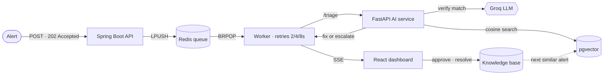

<p align="center">
  
</p>

<p align="center">
  
</p>

<p align="center">
  <a href="https://linkedin.com/in/pratham--ahuja"></a>
  <a href="https://leetcode.com/u/pratham_2005"></a>
  <a href="mailto:ahujapa05@gmail.com"></a>
  <a href="https://drive.google.com/file/d/1F6XRxr1pjyzFDXr8BLmCaJgKugaeysUh/view?usp=sharing"></a>
</p>

<p align="center">
  
  
  
  
</p>

---

### `$ whoami`

```java
var pratham = Engineer.builder()
    .education("B.E. Information Science & Engineering @ NIE Mysuru, 2023–2027")
    .core("Java", "Spring Boot", "PostgreSQL", "Redis")
    .alsoUses("Python", "FastAPI", "pgvector", "Docker", "React")
    .enjoys("queues, retries, locking, auth, and what happens when a dependency goes down")
    .lately("putting LLMs inside backend pipelines, with a person approving the output")
    .lookingFor("SDE Intern / New-Grad (June 2027)")
    .locations("Bangalore", "Hyderabad", "Pune", "Mumbai", "Delhi", "Remote")
    .build();
```

```diff
+ Now      : hardening IncidentSense (timeouts, idempotent worker, service-to-service auth)
+ Learning : system design at scale, Python/AI engineering
- Not doing: putting numbers on my resume that I can't defend in an interview
```

---

### 🛠️ Stack

<p align="center">
  
</p>

| | |
| :--- | :--- |
| **Backend** | Spring Boot · Spring Security (JWT, RBAC) · Spring Data JPA · FastAPI · REST |
| **Data** | PostgreSQL · pgvector · Redis (queues, atomic list ops) |
| **AI** | Sentence-Transformers embeddings · vector search · LLM APIs (Groq) · RAG |
| **Infra** | Docker Compose · GitHub Actions CI/CD · nginx · Linux · Azure VM |
| **Testing** | JUnit · Mockito · JaCoCo |

---

### 🚀 Featured work

<table>
<tr>
<td colspan="2">

#### 🚨 [IncidentSense](https://github.com/pratham-ahuja05/incident-triage-system) — AI-assisted incident triage
[**Live**](https://incidentsense.duckdns.org) · [**Demo video**](https://drive.google.com/file/d/1EMiDwaJuj5V-1NAqe7BLdrIytrRXUkSZ/view?usp=drive_link)

Matches a new production alert to past resolved incidents and suggests the fix that worked last time, or escalates when the problem looks new. **A person always approves.**



- **Async pipeline:** the API answers `202 Accepted` and a Redis-queue worker does the slow AI work, with exponential-backoff retries. Dashboards update live over SSE.
- **Retrieval + verification:** `all-MiniLM-L6-v2` embeddings and pgvector cosine search, then a distance threshold plus an LLM check decide between suggesting the past fix and escalating to Slack.
- **Learns from people:** approved fixes and human resolutions go back into the knowledge base. LLM classification sets P1–P4 priority and SLA due dates.
- **Platform:** JWT auth with four roles, Jira-style workflow with an audit log, Docker Compose on an Azure VM shipped by GitHub Actions.

      

<sub>The knowledge base is seeded with synthetic incidents for now, so no accuracy numbers are claimed.</sub>

</td>
</tr>
<tr>
<td width="50%" valign="top">

#### 🔄 [Distributed Job Queue](https://github.com/pratham-ahuja05/distributed-job-queue)
Fault-tolerant background job processing with separate API and worker services.

- High / medium / low priority queues in Redis
- `rightPopAndLeftPush` hand-off + PostgreSQL `SELECT … FOR UPDATE` so two workers can't claim the same job
- Exponential backoff (2ⁿ), dead-letter queue, recovery scheduler for crashed workers
- Docker Compose · GitHub Actions CI · Mockito + JaCoCo

   

</td>
<td width="50%" valign="top">

#### 🧠 [AI-Assisted Issue Management](https://github.com/pratham-ahuja05/issue-management-system)
An issue tracker with AI features on top.

- Issue lifecycle, search and soft delete
- JWT auth with role-based access control (four roles)
- Semantic duplicate detection with embeddings in pgvector
- LLM features via Groq (Llama 3)

   

</td>
</tr>
</table>

<details>
<summary><b>More projects</b></summary>
<br />

- **[EquiExchange](https://github.com/pratham-ahuja05/equi-exchange):** agent-based trade negotiation (FastAPI, Next.js) with agreed trades settled through Solidity smart contracts (Hardhat, Ethers.js).
- **MeshPay:** college project at NIE. A Spring Boot simulation of offline, UPI-style payments forwarded over a Bluetooth mesh (store-and-forward). Simulation only for now; no real Bluetooth or UPI integration yet.

</details>

---

### 🏆 Beyond code

| | |
| :--- | :--- |
| 🌱 **Open source** | Contributor, GirlScript Summer of Code (GSSoC) |
| ⚡ **Hackathon** | Top 30 at The Big Hack 2025 |
| 🤝 **Leadership** | Industrial Relations Lead, IUCEE NIE Student Chapter (2025–present) |
| 🎓 **Mentoring** | Technical Mentor, Shiksha Mentorship Program: 50+ students in backend and DSA |

<details>
<summary><b>📜 Certifications (Coursera, via NIE)</b></summary>
<br />

- Object Oriented Programming in Java (UC San Diego)
- Java Programming: Solving Problems with Software (Duke)
- Introduction to DevOps · Introduction to Cloud Computing · Encryption and Cryptography Essentials (IBM)
- Linux for Developers (Linux Foundation)

</details>

---

### 🐍 Contributions

<p align="center">
  <picture>
    <source media="(prefers-color-scheme: dark)" srcset="https://raw.githubusercontent.com/pratham-ahuja05/pratham-ahuja05/output/github-snake-dark.svg" />
    <source media="(prefers-color-scheme: light)" srcset="https://raw.githubusercontent.com/pratham-ahuja05/pratham-ahuja05/output/github-snake.svg" />
    
  </picture>
</p>

<p align="center">
  
</p>
